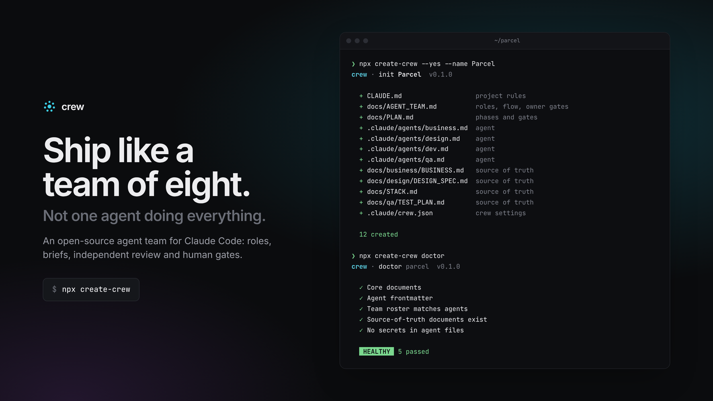
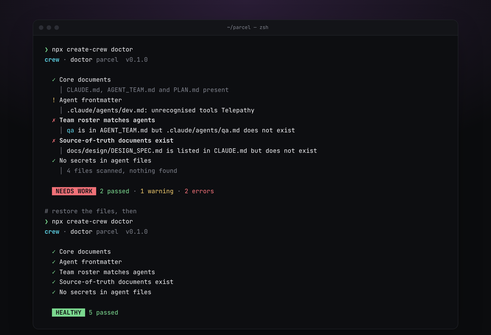
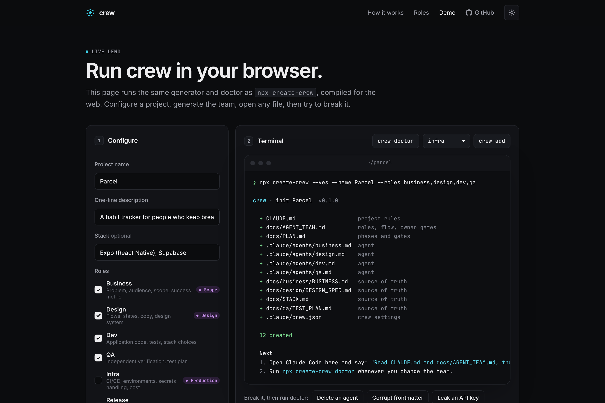

<div align="center">

# crew

**Ship like a team of eight.**
An open-source agent team for Claude Code: roles, briefs, independent review and human gates.

[**Live demo →**](https://mauriciomsouza.github.io/crew/demo.html)

[](https://github.com/mauriciomsouza/crew/actions/workflows/ci.yml)
[](LICENSE)



</div>

## The problem

When you use Claude Code on a real product, one session usually does everything: it scopes the work, designs it, builds it, tests it, and then tells you it is done. Nobody plays a different role, decisions live in chat history, and you end up as the only reviewer of everything.

crew fixes the structure, not the prompts. It sets up an **orchestrator and up to seven role agents** with clear ownership, **source-of-truth documents**, a fixed **handoff** format, and **gates** where you, the human owner, approve. One rule does most of the work: **nobody approves their own work.**

## Quick start

```bash
cd your-project
npx create-crew          # interactive: name, description, stack, roles
npx create-crew doctor          # validate the setup (exits 1 on errors)
```

Then open Claude Code in the project and say:

> Read CLAUDE.md and docs/AGENT_TEAM.md, then propose the first brief.

Non-interactive, for scripts and CI:

```bash
npx create-crew --yes --name Parcel --roles business,design,dev,qa,release
npx create-crew add infra       # add a role later; team tables update in place
```

crew never overwrites an existing file unless you pass `--force`, and `--dry-run` shows the plan without writing anything.

## What gets generated

```text
your-project/
├── CLAUDE.md                     project rules: source-of-truth table, inviolable rules, how to work
├── docs/
│   ├── AGENT_TEAM.md             roles table, iteration flow, owner gates, team rules
│   ├── PLAN.md                   phases and gates G0…Gn, risks, decision log
│   ├── STACK.md                  ← owned by dev
│   ├── business/BUSINESS.md      ← owned by business
│   ├── design/DESIGN_SPEC.md     ← owned by design
│   └── qa/TEST_PLAN.md           ← owned by qa
└── .claude/
    ├── crew.json                 your choices, so `crew add` can regenerate tables
    └── agents/
        ├── business.md           frontmatter (name, description, tools) + role prompt
        ├── design.md
        ├── dev.md
        └── qa.md
```

Every file is plain Markdown that Claude Code already understands. There is no runtime: delete the files and crew is gone. See the full output for a fictional product in [`examples/parcel`](examples/parcel).

Each role prompt has the same spine: **before you start**, **you own**, **you do not**, **how you work**, **definition of done**, a fixed **handoff** block, and **escalate to the owner when**. The "you do not" section is where most of the value is.

## How an iteration flows

```text
Owner
  │  goal
  ▼
Orchestrator ── writes briefs, routes handoffs, keeps PLAN.md
  │
  ├─▶ business    scope · metric · acceptance criteria   ◆ G1 Scope
  ├─▶ design      flows · states · copy · mockups        ◆ G2 Design
  ├─▶ dev         code · tests · screenshots
  ├─▶ qa          independent verdict, with evidence     ✗ FAIL → back to author
  ├─▶ infra       CI · environments · deploys            ◆ G3 Production
  ├─▶ release     changelog · version · go/no-go         ◆ G4 Ship
  └─▶ marketing   launch drafts per channel              ◆ G5 Publish

◆ stops for the owner’s explicit approval · nobody approves their own work
```

The diagram is generated from the roles you pick, and `crew add` redraws it.

## Roles

| Role | Agent | Owns | Typical deliverable | Gate |
| ---- | ----- | ---- | ------------------- | ---- |
| Orchestrator | main session | Briefs, routing, the plan | Brief per task; updated `PLAN.md` | G0 Kickoff |
| Business | `business` | Problem, audience, scope, success metric | Brief with scope (in / out) and acceptance criteria | Scope |
| Design | `design` | Flows, states, copy, design system | Spec with every state, plus rendered mockups | Design |
| Dev | `dev` | Application code, tests, stack choices | Small tested change, ready for review | |
| QA | `qa` | Independent verification, test plan | PASS or FAIL verdict with evidence | |
| Infra | `infra` | CI/CD, environments, secrets handling, cost | Green pipeline and a runbook with rollback | Production |
| Release | `release` | Versioning, changelog, release checklist | Versioned release and a go/no-go question | Ship |
| Marketing | `marketing` | Positioning copy, launch plan, announcements | Ready-to-post drafts per channel | Publish |

The default team is business, design, dev and qa: the smallest team that still has a scope gate and independent review.

## `crew doctor`

A linter for your team setup. Run it locally or in CI.



| Check | Fails when |
| ----- | ---------- |
| Core documents | `CLAUDE.md` or `docs/AGENT_TEAM.md` is missing |
| Agent frontmatter | YAML is invalid, `name` is missing or does not match the file, `description` is empty, `tools` is malformed |
| Team roster | A role in the `AGENT_TEAM.md` table has no agent file, or an agent file is not in the table |
| Source of truth | A document listed in the `CLAUDE.md` source-of-truth table does not exist |
| Secrets | An agent file contains something shaped like a private key, cloud key or API token (shown redacted) |

Add it to CI:

```yaml
- run: npx create-crew doctor
```

## Live demo

The [demo](https://mauriciomsouza.github.io/crew/demo.html) runs the real generator and doctor in your browser. They are compiled from the same `src/core` as the CLI, so the demo cannot drift from what `npx` produces. Configure a project, generate it, open every file, add a role, then break things and watch doctor catch them.



## How this repo is built

crew is built by its own crew. This repository uses exactly the structure it generates:

- [`CLAUDE.md`](CLAUDE.md): rules for agents working on crew, such as "never overwrite user files silently" and "templates are generic"
- [`docs/AGENT_TEAM.md`](docs/AGENT_TEAM.md): the eight-seat team that builds and operates crew, with its gates
- [`.claude/agents/`](.claude/agents): seven agents written for this codebase, not copies of the templates
- [`docs/PLAN.md`](docs/PLAN.md), [`docs/STACK.md`](docs/STACK.md), [`docs/business/BUSINESS.md`](docs/business/BUSINESS.md), [`docs/design/DESIGN_SPEC.md`](docs/design/DESIGN_SPEC.md), [`docs/marketing/LAUNCH.md`](docs/marketing/LAUNCH.md): the source-of-truth documents each role owns

CI runs `crew doctor` on this repo, so the dogfooding is enforced rather than claimed.

Design decisions worth reading:

- **A pure core.** `src/core` has no Node or DOM imports. The CLI wraps it with a file system; the demo wraps it with an in-memory repo.
- **One write path.** Every file write goes through `writeFiles`, which decides created / updated / kept / unchanged. That is how "never overwrite" stays true.
- **Marker-managed sections.** `crew add` regenerates only what sits between `<!-- crew:roles:start -->` and `<!-- crew:roles:end -->` (and similar markers). Your edits around them survive.
- **Templates that fail loudly.** A placeholder typo throws in tests instead of shipping as `{{project.nmae}}`.

## Development

```bash
npm ci
npm run check      # typecheck · lint · test · build · crew doctor
npm run preview    # site at http://localhost:4173/crew/
npm run screens    # re-render docs/design/screens/*.png
```

See [CONTRIBUTING.md](CONTRIBUTING.md).

## Roadmap

- `crew brief <role>`: create a brief from a template and route it to the right agent
- `crew upgrade`: merge template updates into agent files you have customised
- Custom role packs (`--pack ./my-roles`) for teams with their own conventions
- Doctor rules for stale documents and for agents granted tools their role should not need

Roadmap items are not commitments; see [docs/PLAN.md](docs/PLAN.md).

## License

[MIT](LICENSE) © Mauricio Souza
